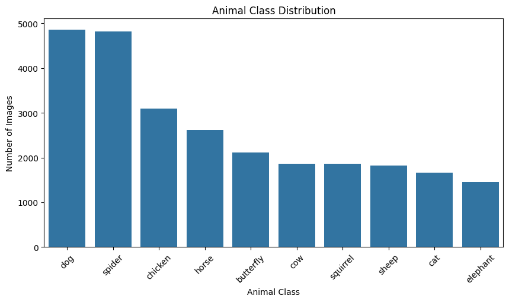
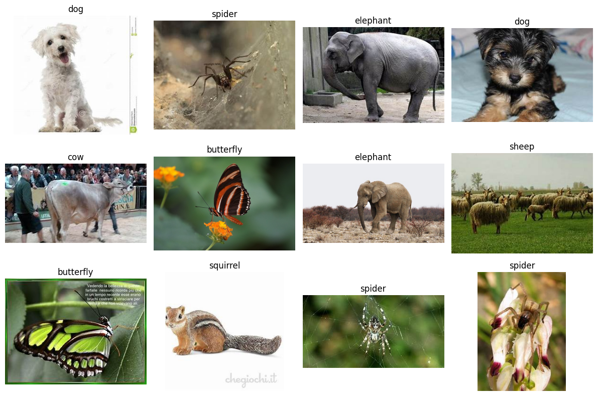
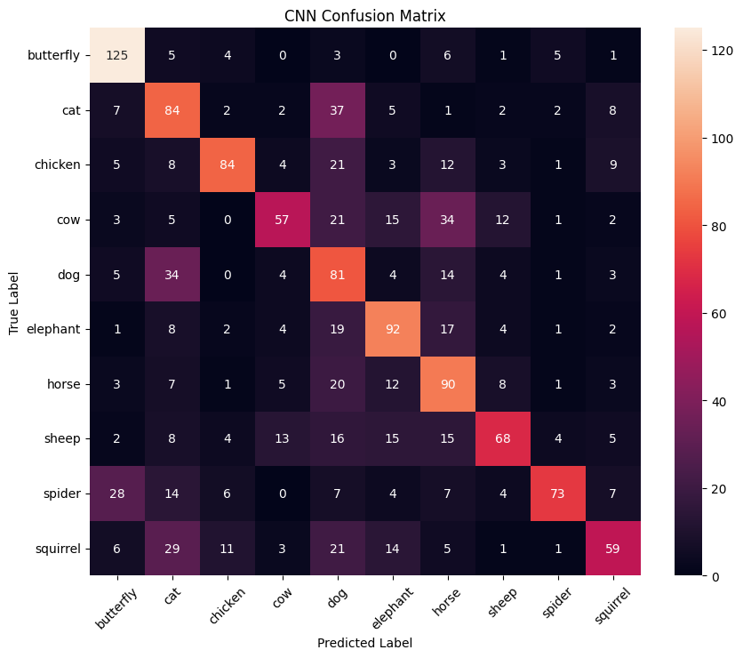
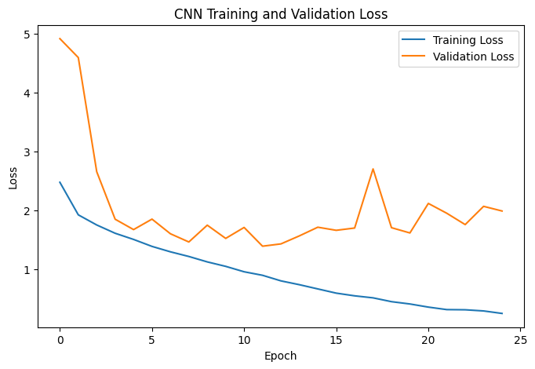
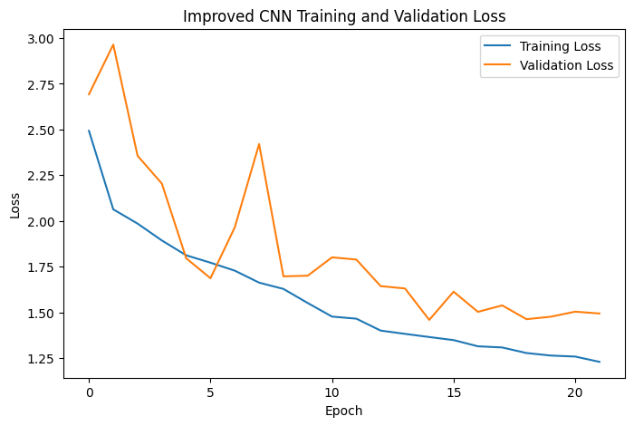

# Animal Species Classification with Machine Learning and Deep Learning

Comparison of supervised image classifiers and unsupervised clustering on the **Animals-10** dataset. The analysis was developed in **Python using Google Colab**, TensorFlow/Keras and scikit-learn.

## Project overview

The goal is to classify images into ten animal classes: butterfly, cat, chicken, cow, dog, elephant, horse, sheep, spider and squirrel. The raw dataset contains **26,179 images**. The experiment uses a balanced subset of **10,000 images**, with **1,000 images per class**. All model inputs are resized to **32 × 32 RGB** pixels.

## Main results

| Method | Reported accuracy | Notes |
| --- | ---: | --- |
| Multilayer Perceptron | 15.80% | Baseline on flattened pixels |
| Random Forest | 35.67% | Ensemble classifier on flattened pixels |
| Convolutional Neural Network | **54.20%** | Best supervised test result in this experiment |
| Improved CNN | 47.53% | Augmentation and regularisation reduced overfitting but also lowered test accuracy |
| MiniBatch K-Means | 17.55% | Cluster-to-label matching on the combined dataset; not directly comparable to the held-out test results above |

The CNN produced the strongest supervised classification result, although 54.2% test accuracy is not sufficient for high-stakes deployment. The improved CNN did not outperform the baseline CNN. See the report for the full methodology, confusion matrices and limitations.

## Visual results

### Class distribution

### Example animals

### CNN results

### Comparing CNN and improved CNN

| Original CNN | Improved CNN |
| --- | --- |
|  |  |

## Methods

- Exploratory data analysis, per-class sample balancing, resizing, pixel normalisation and label encoding
- Data split: 7,000 training, 1,500 validation and 1,500 test images
- MLP, Random Forest, CNN and improved CNN classification
- PCA dimensionality reduction followed by MiniBatch K-Means clustering
- Evaluation using accuracy, classification reports, confusion matrices and clustering metrics

## Files

- [`Animal_Species_Classification.ipynb`](Animal_Species_Classification.ipynb) - complete Python notebook with original code and saved results. Section headings were added for browsing; executable source was not changed.
- [`Animal_Species_Classification_Report.pdf`](Animal_Species_Classification_Report.pdf) - written analysis and model evaluation (university cover removed).
- [`assets/`](assets/) - original visualisations extracted from the notebook.
- [`data/README.md`](data/README.md) - dataset acquisition and setup instructions.

## How to run

1. Open the notebook in **Google Colab**. Enable a GPU runtime where available.
2. Download the [Animals-10 dataset from Kaggle](https://www.kaggle.com/datasets/alessiocorrado99/animals10).
3. Place the ZIP at `MyDrive/animal_class/archive.zip` in your Google Drive.
4. Run the notebook from top to bottom. It mounts Google Drive, extracts data to `/content/animals10`, loads images and trains models.
5. Model training takes time and results may vary across versions and hardware.

The repository does not bundle dataset images, weights or a prepared dataset. The notebook may require adjustment if the downloaded archive layout differs.

## Key limitations

- Downsampling to 32 × 32 pixels loses visual detail, which limits model performance.
- Balancing each class to 1,000 images reduces the amount of available training data.
- The CNN exhibits overfitting and the augmented CNN performs worse on the held-out test set.
- Clustering uses low-level pixel patterns and does not accurately recover animal categories.
- Do not treat exploratory associations or model scores as a production-ready wildlife classifier.

## Dataset attribution

Animals-10 dataset by Alessio Corrado on [Kaggle](https://www.kaggle.com/datasets/alessiocorrado99/animals10). All original dataset rights and usage terms remain with the dataset provider.

## Author
Mohamed Hassanien
